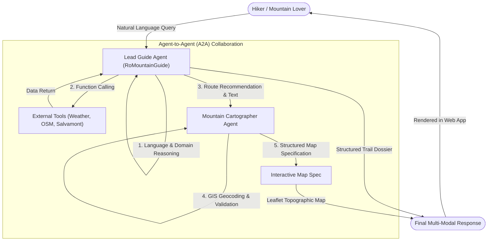

# RoMountainAgent

**RoMountainAgent** is an intelligent AI mountain guide built to help mountain lovers and outdoor enthusiasts safely explore the Romanian Carpathians (Fagaras, Bucegi, Piatra Craiului, Retezat, Ceahlau, Parang, Apuseni, and beyond).

The guide provides hikers with verified trail itineraries, official markings, real-time alpine weather alerts, official Salvamont safety recommendations, and interactive topographic maps.

---

## 1. What is RoMountainAgent?

Planning a mountain hike in the Carpathians requires accurate, realistic information: trail markings, elevation gain, technical exposure, water sources, and rapidly changing high-altitude weather. 

RoMountainAgent acts as an interactive alpine companion that:
- Helps mountain lovers discover routes tailored to their experience level.
- Communicates naturally in the hiker's preferred language (Romanian, English, Spanish, etc.).
- Integrates live meteorological warnings and official Romanian mountain rescue (Salvamont) protocols.
- Enables hikers to download an offline Markdown trail dossier directly to their smartphone for use when there is no mobile reception on the mountain.

---

## 2. Agent-to-Agent (A2A) Architecture

Rather than relying on a single monolithic prompt, RoMountainAgent is engineered around an **Agent-to-Agent (A2A)** collaborative multi-agent architecture. Two specialized agents work together to create every recommendation:



### The Two Specialized Agents:

1. **RoMountainGuide (Lead Alpine Guide Agent)**
   - Responsible for conversational understanding and multilingual mirroring (responding strictly in the language of the hiker).
   - Coordinates domain logic, difficulty assessment, and Salvamont safety procedures.
   - Executes autonomous function calling to fetch live high-altitude weather and query OpenStreetMap hiking relations.
   - Formats the final route into a structured 6-section Mountain Trail Dossier.

2. **Mountain Cartographer Agent (GIS Specialist Agent)**
   - Receives the route and trail milestones produced by the Lead Guide.
   - Identifies, normalizes, and extracts sequential waypoints (trailheads, intermediate cabins, water springs, saddles/passes, and summits).
   - Validates coordinates against a ground-truth Carpathian GIS database.
   - Generates a structured JSON map specification (coordinates, bounds, and waypoint classifications) consumed by the frontend mapping engine.

---

## 3. End-to-End Workflow: From Question to Final Response

The lifecycle of each user query follows a multi-stage pipeline:

```
[User Question] -> [Language & Intent Detection] -> [Autonomous Tool Execution] -> [A2A Cartographer Handoff] -> [Final Response with Interactive Map & Offline Export]
```

### Stage 1: The Question (Hiker Input)
The user enters a query in natural language (for example, *"Recomanda-mi un traseu de o zi spre Varful Omu din Busteni"* or *"Show me a scenic hike in Piatra Craiului"*).

### Stage 2: How the Agent Builds the Answer
1. **Language Mirroring**: The system detects the query language and ensures all headings, explanations, and safety notes are generated in that exact language.
2. **Alpine Knowledge & Live Data Gathering**:
   - Calls the weather tool with coordinate resolution to retrieve real-time temperatures, wind speeds, and ridge hazard alerts from Open-Meteo.
   - Queries OpenStreetMap via Overpass API to identify certified hiking trail relations, trail marks, and network operators.
   - References official Salvamont rules for equipment checklists, seasonal warnings, and bear encounter safety rules.
3. **A2A Cartographer Processing**:
   - The Cartographer Agent analyzes the generated itinerary and identifies the geographic milestones.
   - Coordinates are geocoded and verified, calculating the optimal camera center and bounding box for the map.

### Stage 3: The Final Response
The hiker receives a complete, multi-modal response:
- **6-Section Mountain Trail Dossier**:
  1. Quick Summary (massif, starting point, official marking, difficulty, duration, elevation gain).
  2. Itinerary and Waypoints (stages, water sources, alpine huts).
  3. Live Weather and Ridge Conditions (temperatures, wind chill, weather alerts).
  4. Hazards, Difficulties, and Salvamont Safety Rules.
  5. Recommended Gear Checklist.
  6. Emergency Contacts (0-SALVAMONT / 112).
- **Interactive Topographic Map**: Plotted directly below the message using Leaflet with OpenTopoMap contour tiles, featuring color-coded waypoint markers.
- **Offline Download Option**: A 1-click button (`[Save Trail Dossier to Phone (.md)]`) downloads the entire dossier to the user's phone for offline consultation on the trail.
- **Generation Control**: An interactive Stop button allows the user to immediately cancel ongoing response generation if needed.

---

## 4. The Server & Testing with Passcode Protection

The application includes an asynchronous FastAPI web server that powers both the API and the mobile-friendly Progressive Web App (PWA).

### Private Access Gate
To protect the AI agent and prevent unauthorized consumption of API tokens, the application is protected by a **passcode gate**:
- The server checks every incoming request against a secure passcode configured via environment variables (`APP_ACCESS_PASSCODE`).
- When visitors open the web interface, a clean modal prompts for the access passcode before granting entry.
- **Testing the Application**: The live server is testable and accessible on phones or desktop browsers for authorized users. Access passcodes are distributed privately by the author/administrator upon request.

### Running Locally for Testing:
1. Clone the repository and configure your `.env` file (refer to `.env.example`).
2. Install dependencies:
   ```bash
   pip install -r requirements.txt
   ```
3. Start the application server:
   ```bash
   python app_server.py
   ```
4. Open `http://localhost:8000` in your browser and enter your configured access passcode.

---

## 5. Technologies Used

- **Language & Runtime**: Python 3.10+
- **Large Language Model**: Google Gemini (`gemini-3.5-flash-lite`) via the official `google-genai` SDK
- **Multi-Agent Architecture**: Agent-to-Agent (A2A) orchestration with standardized `AgentCard` descriptors
- **Backend Framework**: FastAPI with Uvicorn ASGI server
- **Frontend & Web UI**: Progressive Web App (PWA) built with vanilla HTML5, CSS3, JavaScript, and mobile viewport optimizations
- **Geographic Mapping**: Leaflet.js with OpenTopoMap and OpenStreetMap topographic tile layers
- **External Data Services**:
  - Open-Meteo Forecast API (high-altitude weather, ridge wind gusts, apparent temperature)
  - OpenStreetMap Overpass API (certified hiking routes, trail markings, and networks)
- **Persistence**: Local JSON storage for isolated chat sessions and standalone Markdown trail dossiers
- **Testing**: Automated test suite with `pytest` and FastAPI TestClient (`httpx`)
- **Security**: Passcode authentication headers, CORS middleware, and encrypted environment configuration
